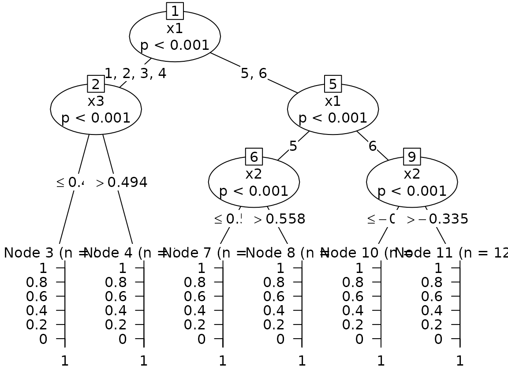

# Logistic regression trees with glmtree

A *logistic regression tree* is a decision tree whose leaves hold
logistic regressions: the tree cuts the population into segments, and
each segment gets its own scoring function. `glmtree` searches such a
tree with a stochastic EM algorithm where the segment of each
observation is a latent variable (see the manuscript linked in the
`README`). This vignette shows the interface on the two simulated
settings of
[`generateData()`](https://adimajo.github.io/glmtree/reference/generateData.md),
and compares with a single logistic regression and with the model-based
recursive partitioning of
[`partykit::glmtree()`](https://rdrr.io/pkg/partykit/man/glmtree.html).

``` r

library(glmtree)
```

## When there is a tree: three segments, three regressions

In the `"tree"` scenario the sign of the effect of `x2` and `x3` depends
on a categorical feature `x1` (its six levels come in three pairs), so a
single logistic regression is misspecified.

``` r

data <- generateData(n = 2000, scenario = "tree")
train <- sample(nrow(data), 1400)
features <- c("x1", "x2", "x3")
```

``` r

fit <- glmtree(
  x = data[train, features], y = data$y[train],
  K = 5, iterations = 100,
  ctree_controls = partykit::ctree_control(alpha = 0.1, minbucket = 80, maxdepth = 4)
)
fit
#> Logistic regression tree fitted by SEM
#>   segments: 3 | best iteration: 35 of 100 
#>   bic of the best tree: -1463 (training set)
#> 
#> Model formula:
#> .segment ~ x1 + x2 + x3
#> 
#> Fitted party:
#> [1] root
#> |   [2] x1 in 1, 2, 3, 4
#> |   |   [3] x3 <= 0.49388: 3 (n = 583, err = 47.7%)
#> |   |   [4] x3 > 0.49388: 4 (n = 359, err = 62.1%)
#> |   [5] x1 in 5, 6
#> |   |   [6] x1 in 5
#> |   |   |   [7] x2 <= 0.55806: 5 (n = 151, err = 1.3%)
#> |   |   |   [8] x2 > 0.55806: 5 (n = 85, err = 56.5%)
#> |   |   [9] x1 in 6
#> |   |   |   [10] x2 <= -0.33494: 5 (n = 96, err = 47.9%)
#> |   |   |   [11] x2 > -0.33494: 5 (n = 126, err = 29.4%)
#> 
#> Number of inner nodes:    5
#> Number of terminal nodes: 6
```

[`predict()`](https://adimajo.github.io/glmtree/reference/predict.md)
gives the probability of the positive class (or, with
`type = "segment"`, the segment) of new observations; the fitted tree is
`fit@best.tree$tree` (a `partykit` object that can be plotted) and the
logistic regression of each segment is in `fit@best.tree$glms`.

``` r

table(true_cluster = data$c[-train], segment = predict(fit, data[-train, features], type = "segment"))
#>             segment
#> true_cluster   3   4   5
#>            1 127  68   0
#>            2 130  65   0
#>            3   0   0 210
plot(fit@best.tree$tree)
```



The evolution of the criterion along the chain (here the BIC, computed
on the training set, higher is better) shows when the chain settles;
only iterations after the burn-in can be selected.

``` r

plot(unlist(fit@performance$criterionEvolution), type = "l", xlab = "Iteration", ylab = "-BIC")
abline(v = fit@performance$best_iteration, lty = 2)
```


We compare the test-set Gini index (2 AUC - 1) with a single logistic
regression and with
[`partykit::glmtree()`](https://rdrr.io/pkg/partykit/man/glmtree.html)
(model-based recursive partitioning, MOB), which looks for splits by a
parameter instability test instead of a likelihood-based latent
variable.

``` r

logit <- glm(y ~ x1 + x2 + x3, data = data[train, ], family = binomial)
mob <- partykit::glmtree(y ~ x2 + x3 | x1 + x2 + x3, data = data[train, ], family = binomial)
c(
  logit = normalizedGini(data$y[-train], predict(logit, data[-train, ], type = "response")),
  mob = normalizedGini(data$y[-train], predict(mob, data[-train, ], type = "response")),
  glmtree = normalizedGini(data$y[-train], predict(fit, data[-train, features]))
)
#>     logit       mob   glmtree 
#> 0.1917357 0.6472518 0.6169301
```

## When there is no tree: apparent clusters but a single regression

In the `"no tree"` scenario the features form three clusters, but `y`
depends on them through one logistic regression. There is nothing to
gain from segmenting, and a good method should not lose much by trying.

``` r

data <- generateData(n = 2000, scenario = "no tree")
train <- sample(nrow(data), 1400)
fit <- glmtree(
  x = data[train, c("x1", "x2")], y = data$y[train], K = 5, iterations = 100,
  ctree_controls = partykit::ctree_control(alpha = 0.1, minbucket = 80, maxdepth = 4)
)
logit <- glm(y ~ x1 + x2, data = data[train, ], family = binomial)
c(
  logit = normalizedGini(data$y[-train], predict(logit, data[-train, ], type = "response")),
  glmtree = normalizedGini(data$y[-train], predict(fit, data[-train, c("x1", "x2")]))
)
#>     logit   glmtree 
#> 0.6652462 0.6634425
```

## Choosing the best tree

The chain draws many trees. Which one is returned depends on `criterion`
(`"bic"`, `"aic"` or `"gini"`) and on where it is computed:

- by default (`validation = FALSE`) the AIC or BIC of the training data
  is used (each segment pays for its parameters, the BIC of a segment
  uses the logarithm of its size);
- with `validation = TRUE` a fraction `proportions` of the data is held
  out and the log-likelihood (no penalty is needed) or the Gini index is
  computed there at each iteration;
- with `test = TRUE` another fraction is held out, never used for
  selection, on which the criterion of the best tree is reported in
  `fit@performance$performance`; `proportions = c(test, validation)`
  when both are used.

`burn_in` is the number of first iterations that cannot be selected, and
`patience` stops the chain when the criterion has not improved for that
many iterations.

``` r

fit <- glmtree(
  x = data[, features], y = data$y, test = TRUE, validation = TRUE,
  proportions = c(0.2, 0.2), criterion = "gini", patience = 50
)
```

## Comparison with a clustering of the features

A popular alternative is to cluster the observations on their features
(for instance on the first principal components) and fit one regression
per cluster. This only helps when the clusters of the features are
related to the heterogeneity of the response, which is not the case in
the `"tree"` scenario: the response depends on the segment through `x1`,
which a PCA of the features does not isolate.

``` r

data <- generateData(n = 2000, scenario = "tree")
train <- sample(nrow(data), 1400)
mixed <- FactoMineR::FAMD(data[train, features], graph = FALSE)
cluster <- function(newdata) stats::predict(mixed, newdata)$coord[, "Dim 1"] < 0
segment <- cluster(data[, features])
pred <- numeric(nrow(data))
for (j in c(TRUE, FALSE)) {
  model <- glm(y ~ x1 + x2 + x3, data = data[train, ][segment[train] == j, ], family = binomial)
  pred[segment == j] <- predict(model, data[segment == j, ], type = "response")
}
normalizedGini(data$y[-train], pred[-train])
#> [1] 0.4744621
```
